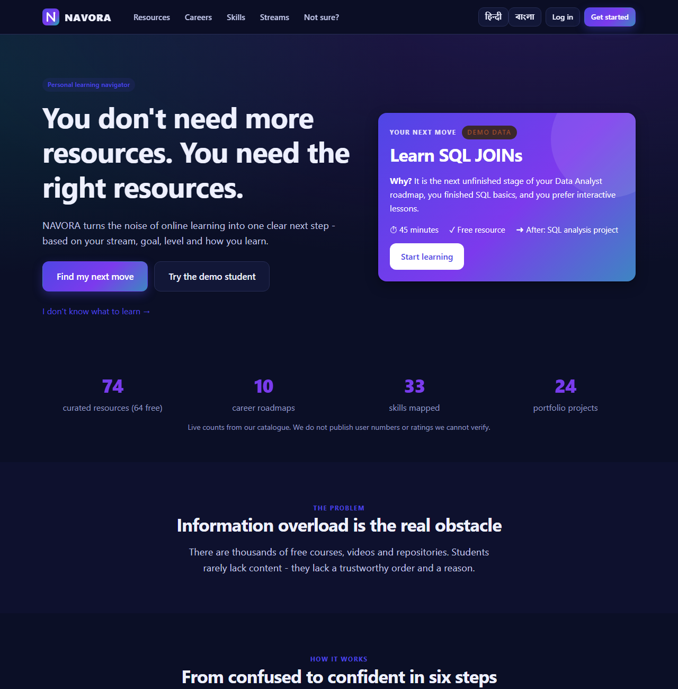
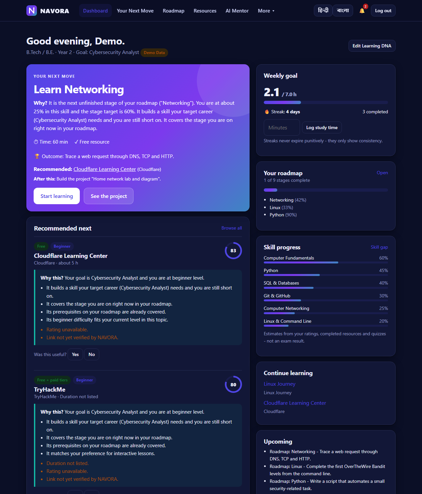
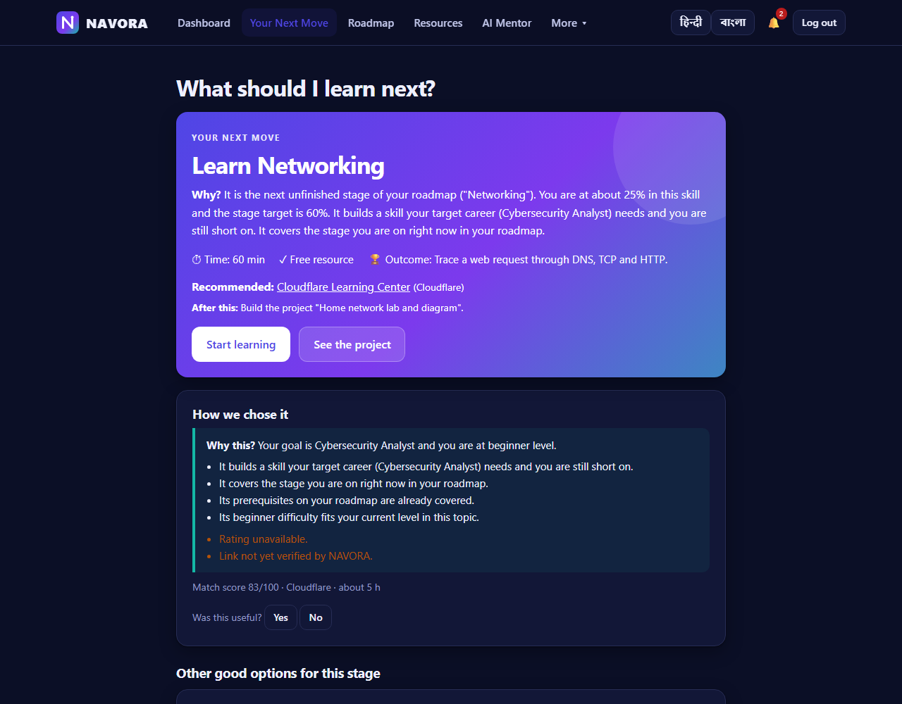
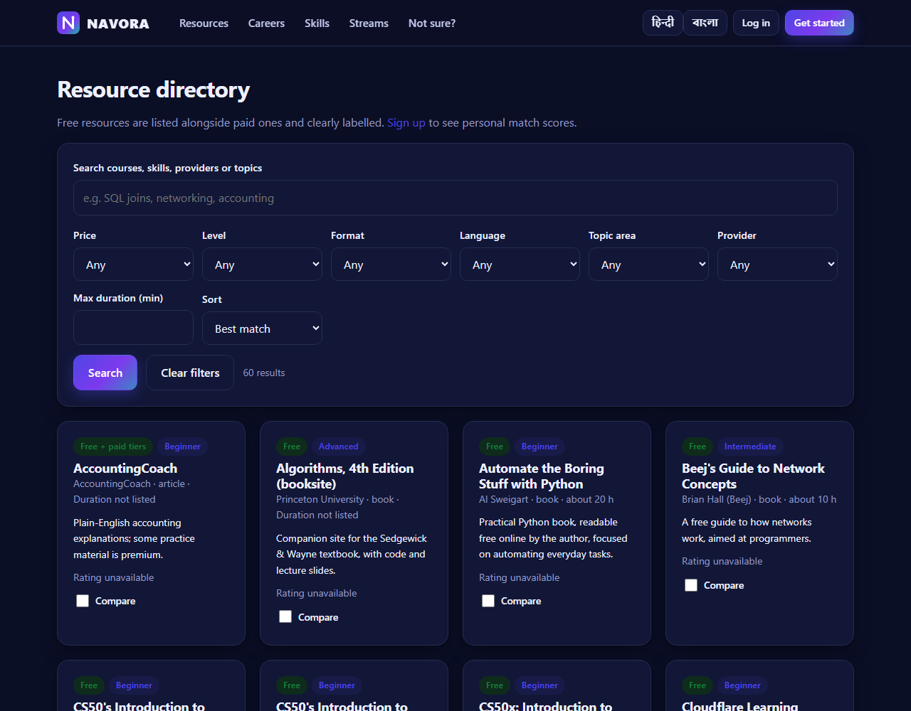
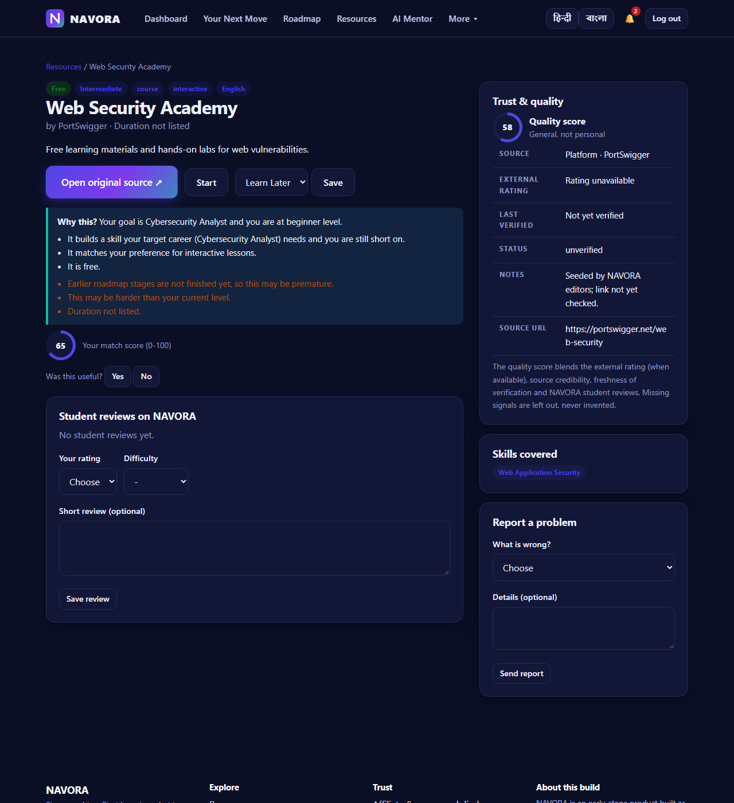
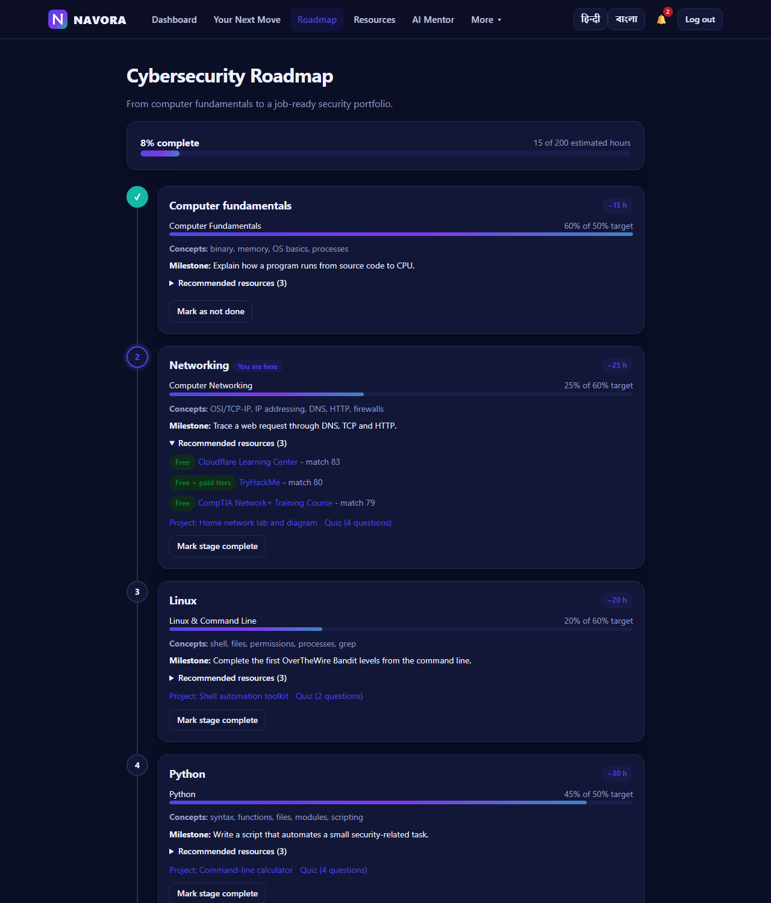
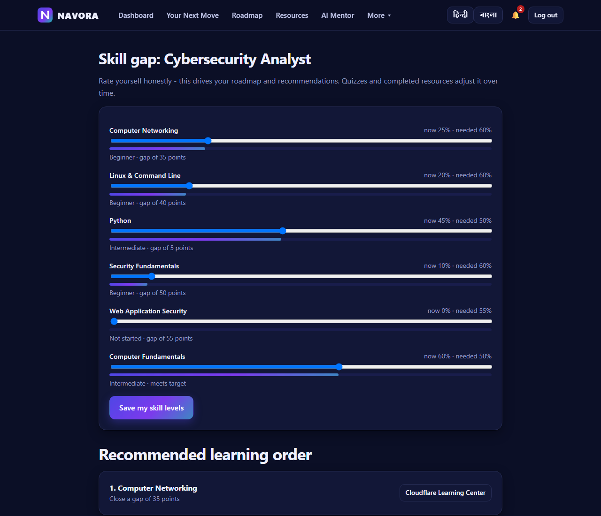
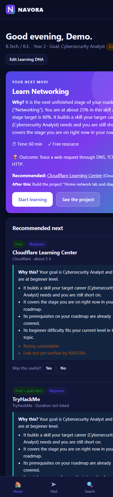
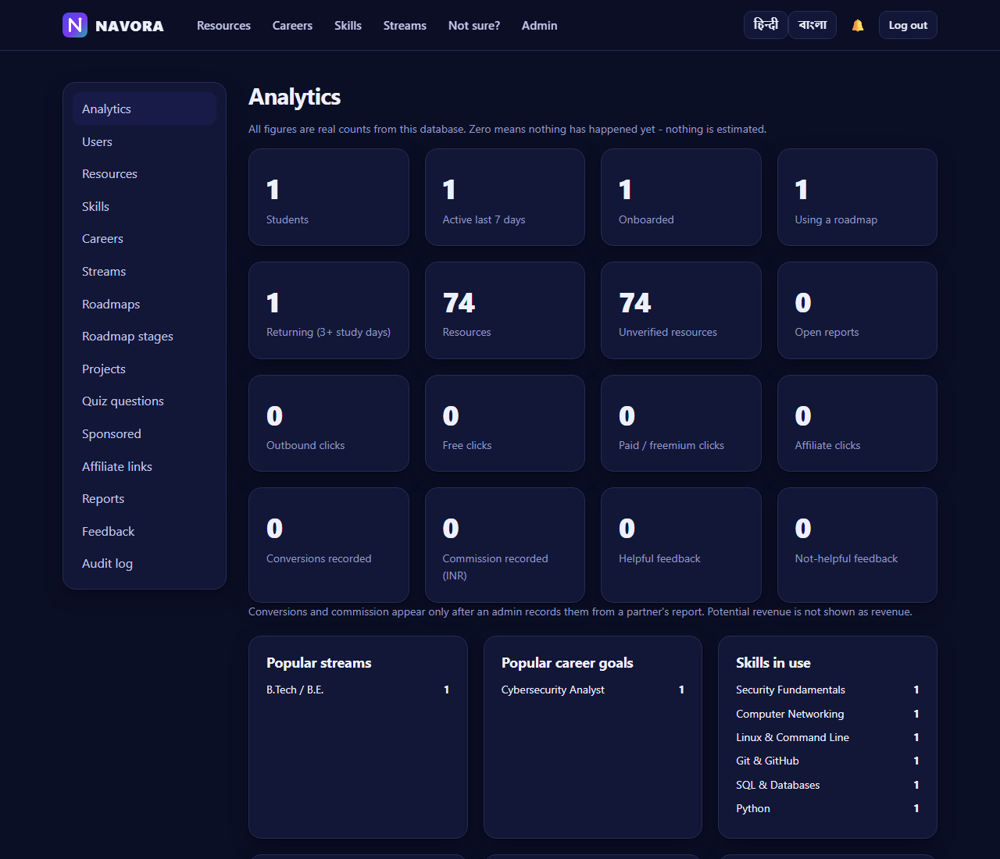

# NAVORA - a personal learning navigator

> **Stop searching. Start knowing what to learn next.**

NAVORA is a Flask web platform that turns the noise of online learning into one clear next step. A student records their *Learning DNA* (stream, year, interests, career goal, level, learning style, time, language, budget) and NAVORA responds with a skill-gap analysis, a roadmap, free-first resources with an explanation for each, projects to build, and a single **Your Next Move** card.

It is built as a B.Tech IT project with a deliberately explainable stack: **Python + Flask, SQLite, Jinja templates, plain CSS/JS**. No front-end framework, no ORM, no external AI service required.

## Features

| Area | What is implemented |
|---|---|
| Landing & discovery | Premium landing page, "I don't know what to learn" 7-question pathway finder, career explorer, streams, skills |
| Onboarding | 7-step Learning DNA flow (education, interests, goal, formats, time, language, budget) + skill self-rating |
| Dashboard | Your Next Move, recommendations with *Why this?*, weekly goal, streak, roadmap and skill progress, upcoming items |
| Recommendation engine | Explainable weighted scoring, configurable weights, free-first mode, feedback learning loop, prerequisite-aware |
| Resource directory | 74 real, attributed third-party resources; search + 8 filters; quality score; comparison (no "winner"); report-a-problem |
| Roadmaps & skill gap | 10 career roadmaps (3-9 stages each), target skill levels, learning order, stage milestones |
| Projects & quizzes | 24 portfolio projects with GitHub checklists, 34 quiz questions across 13 skills |
| Study mentor | 7 modes; offline rule-based answers; optional LLM adapter with graceful fallback |
| Semester & exam mode | Subjects, exam dates, syllabus topics, weak-topic-first revision schedule, last-minute mode |
| Career readiness | Transparent checklist (auto + manual items) |
| Trust | Source, last-verified date, rating source; "Rating unavailable" instead of invented ratings; affiliate/sponsored disclosure |
| Monetisation architecture | Click tracking, affiliate links, manual conversion recording, clearly labelled sponsored slots (no real sponsors yet) |
| Admin panel | Users, resources (+manual verify), skills, careers, streams, roadmaps, stages, projects, quiz, sponsored, affiliates, reports, feedback, analytics, audit log |
| Security | Hashed passwords, CSRF, CSP & security headers, rate limiting, parameterised SQL, escaped output, role checks |
| i18n | English, Hindi, Bengali UI strings (structured, extendable) |

**Honesty rules:** no seeded ratings, reviews, user counts, salaries or testimonials. Anything illustrative is labelled **Demo Data**; unavailable data says *Not available* / *Rating unavailable*. See [docs/business-model.md](docs/business-model.md).

## Screenshots

Captured from the running app with the seeded demo student (all activity shown is **Demo Data**).

| Landing | Dashboard |
|---|---|
|  |  |

| Your Next Move | Resource directory |
|---|---|
|  |  |

| Resource detail (Why this? + trust) | Roadmap |
|---|---|
|  |  |

| Skill gap | Mobile dashboard | Admin analytics |
|---|---|---|
|  |  |  |

## Windows: double-click to run

Double-click **`Start NAVORA.bat`**. On the first run it creates the virtual environment, installs Flask and seeds the database (needs Python 3.10+ installed). It then starts the app and opens http://127.0.0.1:5057 in your browser. Keep the black window open while you use NAVORA; close it to stop.

## Quick start (Windows PowerShell; on macOS/Linux use `python3` and `source .venv/bin/activate`)

```powershell
git clone https://github.com/anuragpatwari591-hub/Gamified-environment.git
cd Gamified-environment
python -m venv .venv
.\.venv\Scripts\Activate.ps1
pip install -r requirements-dev.txt
copy .env.example .env          # edit SECRET_KEY etc.
python -m seed.seed             # creates instance/navora.db; prints a generated admin password ONCE
python run.py                   # http://127.0.0.1:5000
```

* **Demo student:** click **Try the demo student** (B.Tech IT, 2nd year, Cybersecurity goal, beginner). All of its activity is Demo Data.
* **Admin:** `admin@navora.local` (or `ADMIN_EMAIL`) with the password printed by the seed script (or `ADMIN_PASSWORD` if set). Then open `/admin/`.
* Reset everything: `python -m seed.seed --reset`.
* Check seeded links: `python scripts/verify_links.py` (dry run) or `--apply` - see [docs/testing.md](docs/testing.md).

## Tests

```powershell
python -m pytest tests -q
```

84 automated tests cover authentication, authorisation, CSRF, validation, the recommendation engine, search, feedback learning loop, admin CRUD and the mentor fallback. See [docs/testing.md](docs/testing.md) for what is and is not covered.

## Project structure

```
Gamified-environment/
  app/
    __init__.py          application factory, error handlers
    db.py  security.py  i18n.py
    routes/              main (public) · auth · learner · admin · api
    services/            core.py (domain logic) · mentor.py (AI mentor + LLM adapter)
    recommendation/      engine.py (pure scoring) · weights.json (configurable)
    templates/  static/
  database/schema.sql    normalised schema (SQLite)
  seed/                  catalogue, resources, projects, quizzes, demo + admin accounts
  scripts/verify_links.py
  tests/  docs/  config.py  run.py  Procfile
```

## Documentation

[Architecture](docs/architecture.md) · [Database](docs/database.md) · [API](docs/api.md) · [Recommendation engine](docs/recommendation-engine.md) · [Security](docs/security.md) · [Testing](docs/testing.md) · [Deployment](docs/deployment.md) · [Business model](docs/business-model.md) · [Future AI](docs/future-ai.md) · [Viva & project report](docs/viva.md) · [Presentation outline](docs/presentation.md) · [Status](PROJECT_STATUS.md)

## Configuration

See `.env.example`: `SECRET_KEY`, `DATABASE_PATH`, `COOKIE_SECURE`, `SITE_URL`, `ADMIN_EMAIL`, `ADMIN_PASSWORD`, optional `LLM_API_KEY` / `LLM_MODEL`. Secrets are never committed (`.env` and `instance/` are git-ignored).

## Known limitations

See [PROJECT_STATUS.md](PROJECT_STATUS.md). Highlights: single-instance rate limiter, SQLite, no email, no real affiliate partners, Bengali-language resources not yet curated, legal pages need professional review before commercial use.

