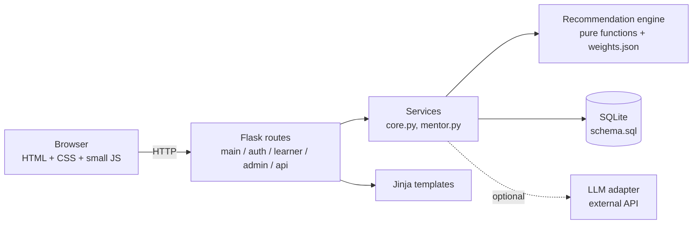
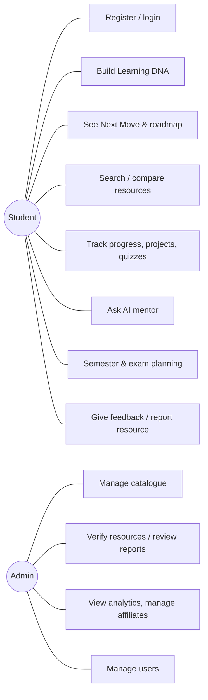
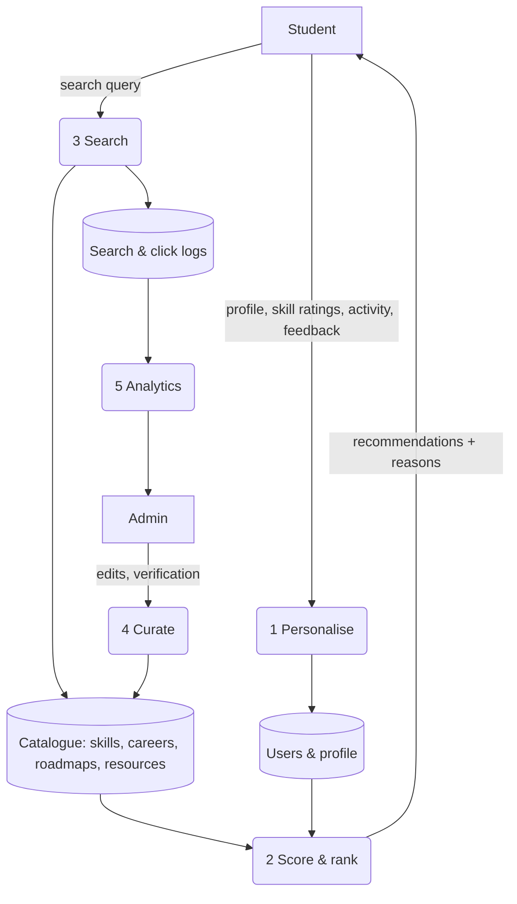

# Architecture

NAVORA is a classic server-rendered three-layer web application.

## Layers

| Layer | Files | Responsibility |
|---|---|---|
| Presentation | `app/templates`, `app/static` | Jinja2 pages, one CSS design system, progressive-enhancement JS (works without JS except the mentor chat) |
| Routes | `app/routes/*.py` | HTTP concerns only: parse input, validate, call services, render |
| Services | `app/services/core.py`, `mentor.py` | Domain logic: building the user context, roadmap progress, skill gap, activity, readiness, search |
| Engine | `app/recommendation/engine.py` | Pure, DB-free scoring and "Next Move" selection - unit-testable |
| Data | `app/db.py`, `database/schema.sql` | SQLite via `sqlite3`, parameterised queries, foreign keys on |
| Cross-cutting | `app/security.py`, `app/i18n.py` | CSRF, rate limit, headers, auth decorators, translations |

## Key design decisions (viva-friendly)

* **Flask + SQLite, no ORM:** every SQL statement is visible and explainable; the schema is plain SQL. SQLite needs no server, which keeps the demo reproducible. `database/schema.sql` is portable to MySQL with minor syntax changes.
* **Engine as pure functions:** `score_resource(resource, context)` takes dicts and returns numbers plus reasons. That makes it testable and lets us explain the algorithm on one page.
* **Explainability by construction:** each scoring component emits its own reason string; the UI only displays them.
* **Graceful degradation:** the AI mentor goes `LLMAdapter` -> deterministic fallback on *any* adapter failure.
* **Trust over engagement:** no manufactured ratings, sponsored placements are separate from organic ranking, streaks do not punish.
* **Admin CRUD is data-driven:** `ENTITIES` in `routes/admin.py` describes each table's fields once; one set of templates serves all of them.

## Request flow example - "Your Next Move"

1. `GET /next` -> `learner.next_move` (login required, onboarding checked).
2. `core.get_next_move(uid)` loads the profile, builds an engine *context* (career skills, current skill levels, formats, language, budget, feedback history), loads roadmap stages and determines which are done (`done = manual OR skill level >= target`).
3. `engine.next_move()` picks the first unfinished stage, scores resources tagged with that stage's skill, and returns title, reason, time, resource, outcome and what comes after.
4. The template renders it with the "Why?" explanation and feedback buttons; feedback is stored and alters the next call.

## Use cases

## Data-flow diagram (level 1)

## Module / class structure

There are no classes beyond the `LLMAdapter` hierarchy; the code is function-based modules. Public functions: `engine.quality`, `engine.score_resource`, `engine.rank`, `engine.next_move`; `core.build_context`, `core.roadmap_stages`, `core.skill_gap`, `core.complete_resource`, `core.readiness`, `core.search_resources`; `mentor.reply` with `LLMAdapter` / `HTTPAdapter`.
