# Database design

SQLite, created from [`database/schema.sql`](../database/schema.sql) (`python run.py` or `python -m seed.seed` runs it). Foreign keys are enforced (`PRAGMA foreign_keys=ON`); `CHECK` constraints validate enums and ranges.

## ER diagram (core)

```mermaid
erDiagram
  users ||--|| profiles : has
  users ||--o{ user_interests : picks
  users ||--o{ user_formats : prefers
  users ||--o{ user_skills : rates
  users ||--o{ learning_progress : tracks
  users ||--o{ study_sessions : logs
  users ||--o{ bookmarks : saves
  users ||--o{ user_projects : works_on
  users ||--o{ recommendation_feedback : gives
  users ||--o{ resource_reviews : writes
  users ||--o{ semester_subjects : plans
  semester_subjects ||--o{ syllabus_topics : contains
  streams ||--o{ profiles : "studied in"
  careers ||--o{ profiles : "targeted by"
  careers ||--o{ career_skills : requires
  skills  ||--o{ career_skills : "required for"
  careers ||--|| roadmaps : has
  roadmaps ||--o{ roadmap_stages : contains
  skills ||--o{ roadmap_stages : teaches
  users ||--o{ user_stages : completes
  resources ||--o{ resource_skills : covers
  skills ||--o{ resource_skills : "covered by"
  projects ||--o{ project_skills : needs
  skills ||--o{ project_skills : "needed by"
  skills ||--o{ quiz_questions : tests
  resources ||--o{ resource_clicks : receives
  resources ||--o{ affiliate_clicks : receives
  resources ||--o{ reports : "reported in"
  resources ||--o{ learning_progress : "tracked in"
```



## Tables (34 in total, only those the product needs)

| Group | Tables |
|---|---|
| Identity | `users`, `profiles`, `user_interests`, `user_formats`, `user_skills` |
| Catalogue | `streams`, `skills`, `careers`, `career_skills`, `roadmaps`, `roadmap_stages`, `resources`, `resource_skills`, `projects`, `project_skills`, `quiz_questions` |
| Learner activity | `user_stages`, `learning_progress`, `study_sessions`, `bookmarks`, `user_projects`, `quiz_attempts`, `readiness_items`, `semester_subjects`, `syllabus_topics`, `notifications` |
| Feedback & trust | `recommendation_feedback`, `resource_reviews`, `reports` |
| Monetisation & analytics | `resource_clicks`, `affiliate_clicks`, `sponsored_content`, `search_log` |
| Admin | `audit_logs` |

## Normalisation notes

* Many-to-many relations (resources<->skills, projects<->skills, careers<->skills) use junction tables with composite primary keys - 1NF/2NF.
* User interests and formats are separate rows, not comma-separated columns.
* Deliberate denormalisation: `resources.tags`, `careers.interest_tags`, `careers.degree_backgrounds` and `projects.checklist` are free-text for editorial convenience; they are never joined on.
* Rating data is split: `resources.rating*` (external, with `rating_source`) vs `resource_reviews` (NAVORA students). They are never merged.

## Trust fields on `resources`

`source_url`, `source_kind`, `rating` (nullable), `rating_count`, `rating_source`, `last_verified_at` (nullable), `status` (`unverified|active|broken|outdated|hidden`), `verification_notes`, `pricing`, `price_inr` (nullable), `affiliate_url`.

## Indexes

`resources(status)`, `resources(pricing)`, `resources(category)`, `resource_skills(skill_id)`, `study_sessions(user_id, day)`, plus all primary/unique keys.

## Setup

```powershell
python -m seed.seed          # create + seed
python -m seed.seed --reset  # drop all tables, recreate, reseed
```

For MySQL, replace `AUTOINCREMENT` with `AUTO_INCREMENT`, `datetime('now')` with `CURRENT_TIMESTAMP`, `COLLATE NOCASE` with a case-insensitive collation, and swap `sqlite3` for a MySQL driver in `app/db.py` (the rest of the app uses only `q`, `q1`, `run`, `scalar`; a few queries use SQLite upsert syntax `ON CONFLICT ... DO UPDATE`, which would become `ON DUPLICATE KEY UPDATE`).

